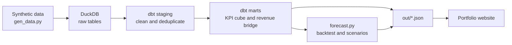

<div align="center">

# Bedbank Analytics Demo

**From a messy booking feed to decisions: tested dbt pipeline, revenue bridge and forecast**


[**Interactive demo**](https://davidprojectsportfolio.netlify.app/) · [LinkedIn](https://www.linkedin.com/in/david-montalb%C3%A1n-290584185/)

</div>

> [!IMPORTANT]
> **All data is synthetic.** The company is fictional (a B2B accommodation wholesaler). No real company or client data is used.

## Contents

[Overview](#overview) · [Pipeline](#pipeline) · [Results](#results) · [Repository structure](#repository-structure) · [Run it](#run-it) · [Limits](#limits)

## Overview

A small end-to-end analytics project that answers two business questions:

1. **Why did revenue change?**
2. **Where will we end the year versus budget?**

| Step | What happens |
|---|---|
| **1. Generate** | About 426,000 fake bookings over 34 months (Jan 2024 to Oct 2026), with deliberate mess: duplicates, inconsistent market codes and test bookings |
| **2. Clean and test** | dbt cleans the data. 17 models and 71 automated tests. A data-quality log counts the rows each rule fixed, so no row is lost silently |
| **3. Explain** | A revenue "bridge" splits the change into four causes: volume, average booking value, mix and take rate |
| **4. Forecast** | Three methods are compared on past data, the best one projects the rest of the year, and a scenario tool shows what would move the number |

## Pipeline



## Results

Last 12 months versus the same period a year earlier.

| Metric | Change |
|---|---:|
| **Revenue** | **+4.4%** |
| Volume | +€0.37M |
| Price (average booking value) | +€0.38M |
| Mix | -€0.15M |
| Take rate | -€0.14M |

Revenue grew, but mix and a lower take rate gave back part of the growth. That is what the bridge shows: growth alone does not tell the whole story.

**Forecast.** Holt-Winters had a 1.8% average error three months ahead, against 4.1% for the simple "same month last year" benchmark. FY2026 lands about 3.4% below budget.

## Repository structure

| Path | What it is |
|---|---|
| [`gen_data.py`](gen_data.py) | Generates the synthetic data |
| [`load_raw.py`](load_raw.py) | Loads it into a local database (DuckDB) |
| [`dbt_project/`](dbt_project) | dbt models and tests: cleaning, KPIs, revenue bridge |
| [`forecast.py`](forecast.py) | Forecast, backtest and scenarios |
| [`export_site_data.py`](export_site_data.py) | Exports the results used by the website |
| [`out/`](out) | Exported results (JSON) |
| [`run_all.sh`](run_all.sh) | Runs everything in order |

## Run it

```bash
bash run_all.sh
```

Needs Python 3.11+. Everything runs locally and is free.

## Limits

The data is synthetic, so the findings demonstrate the method, not a real market. 34 months is a short history for a forecast.

## License

MIT, see [`LICENSE`](LICENSE).
